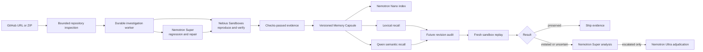

# Architecture

FastAPI serves the authenticated API and repository-memory UI. SQLite stores run
inputs, queue leases, checkpoints, Memory Capsules, embeddings and transactional
budget reservations. The worker dispatches either the reproduce-first repair
pipeline or the memory-audit pipeline.

Memory creation is evidence gated: only a `checks_passed` investigation with a
hash-valid frozen regression can become active memory. Capsules are versioned per
repository, idempotent by source run and explicitly superseded. AI enrichment is
stored separately from the original claim and never rewrites execution evidence.

The sandbox boundary separates three trust zones. The application controller owns
hashes and policy. A network-enabled preparation sandbox receives a static wheel
plan without repository code. Disposable network-disabled sandboxes receive the
repository and selected tests, run as uid 65534 under resource limits, and return
bounded evidence. Friendly image tags are resolved to immutable UUIDs first.

Conflict analysis is evidence triggered. Super sees the proposed-change text,
affected paths and bounded replay output. Ultra receives the same packet plus the
validated Super assessment only when escalation is requested. Neither conflict
stage writes code.

The $25 policy reserves $5 and allows $20 of lifetime application scheduling.
Per-job limits, daily limits, call counts and reconciled sandbox costs prevent a
retry loop from consuming the credit pool. Provider billing controls remain the
authoritative monetary limit.

